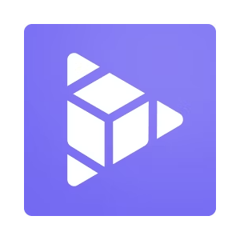
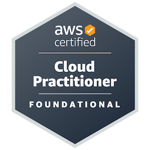
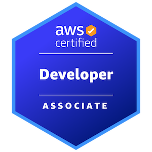
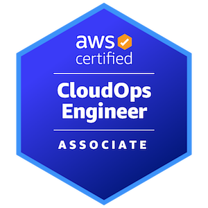
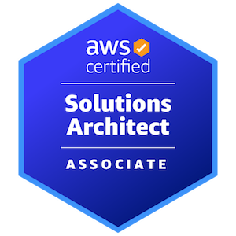
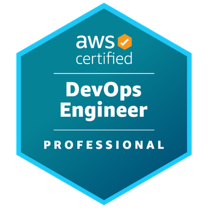
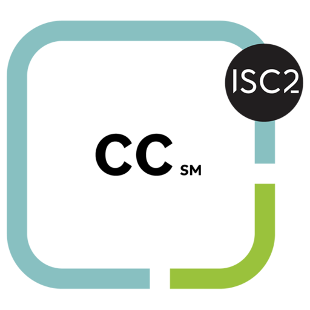
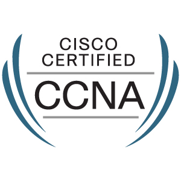

## Hi, I'm Bach 👋

 <i>← You can check out my website</i>

🔭 I'm a software developer with a few years of experiences in web development. Most of the time my tech stack includes: Next.js, Express, Tailwind CSS.

🌱 Besides trying to study other languages and improve on my software development side, I'm currently self-studying and fiddling around with Three.js, Kubernetes, and other DevOps & SysOps stuffs as well

🏆 I have achieved some certificates (and still hungry for more 💪)

